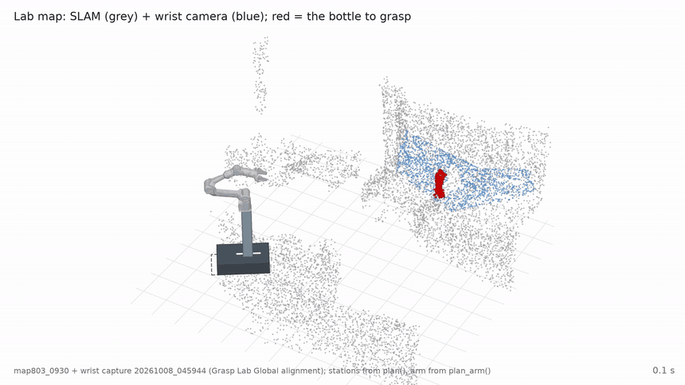
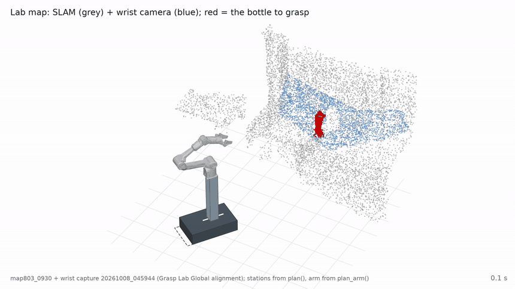
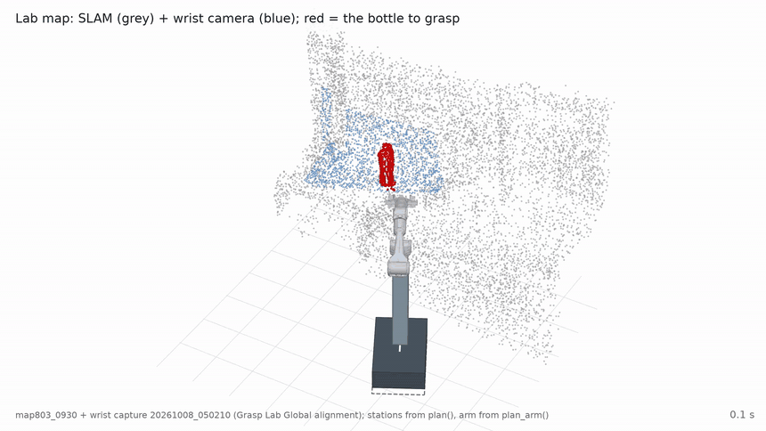
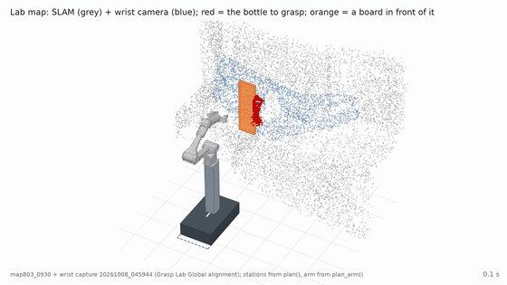
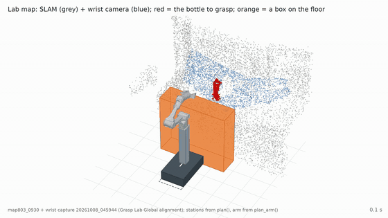

# curobo-base-placement

**Where should the Kachaka base stand so its arm can grasp?** Upstream has already decided what to grasp and the gripper's
final pose. Given the 3D SLAM point cloud and that gripper pose, this project returns the base pose (x, y, yaw) for
Kachaka's `Navigate_to_pose`, checked so that from there the arm still reaches **the same gripper pose** without
collisions — even if Kachaka stops ±5 cm / ±5° off. Grasps that cannot be done are rejected with a reason.

- Robot: Kachaka mobile base + AgileX Piper 6-DoF arm (Robot129).
- Planner: [cuRobo v2](https://github.com/NVlabs/curobo), 9-DoF whole-body IK (base x, y, yaw + 6 arm joints).
- Runs on the Jetson Thor or any CUDA GPU: about **1 s per grasp** on the Thor once started.

It does not choose grasps, plan the navigation path, or build / align maps.

## Examples

The lab's map803 SLAM map with a real wrist capture (Grasp Lab Global). The board and the box are added obstacles.
Grey = SLAM points, blue = wrist camera, red = the bottle, green rectangle = the base pose we output.

| Starting 1.5–1.9 m away: drive to the right spot | Starting 1.0–1.4 m away |
|:---:|:---:|
|  |  |
| a side grasp; drives 1.45 m to a 27/27 spot · [mp4](docs/media/far2.mp4) | the executed grasp; drives 0.34 m · [mp4](docs/media/far.mp4) |
| **Already beside it: a small correction** | **Board in front: reject the front grasp, use a side grasp** |
|  |  |
| 21/27 where it stands, moves 0.10 m to 27/27 · [mp4](docs/media/near.mp4) | front grasp rejected (no IK solution); side grasp after driving 0.51 m · [mp4](docs/media/board.mp4) |
| **Box in front: move, then reach over it** | |
|  | |
| 9/27 where it stands, moves 0.17 m to 27/27 · [mp4](docs/media/box.mp4) | |

## Use it in the robot system

### 1. Start it with the container

Clone it on the Thor next to `mm_system_prod`. It is mounted into the container, so updating is a `git pull` plus a
container restart, with no image rebuild:

```bash
git clone https://github.com/wyattsheu/curobo-base-placement.git /home/acm/curobo-base-placement
```

It runs in the lab's `mm-gpu` image (the one `mm_actions_node` uses); nothing to install. Add to the container's
`docker run` (e.g. `mm_system_prod/run.sh`):

```bash
  -v /home/acm/curobo-base-placement:/workspace/curobo-base-placement \
  -v <folder holding the map folders>:/maps:ro \
  -v /home/acm/curobo-base-placement/.warp_cache:/root/.cache/warp \
  -e CUROBO_MAP_CACHE=/workspace/curobo-base-placement/.map_cache \
```

Then load it once when the node starts, on the same GPU thread as the other models. The map is passed in as a
folder, the lab's exported map of the current environment (example name `map803_0930`):

```python
sys.path.insert(0, "/workspace/curobo-base-placement")
from base_placement import BasePlacement
bp = stack.run(BasePlacement, map_dir)                   # e.g. map_dir = "/maps/map803_0930"; ~15 s, once
```

A new environment only needs its newly scanned map folder: pass that folder here, or switch while running with
`stack.run(bp.set_map, new_map_dir)`. Each new map is processed once (a few seconds) and cached.

The map folder is the lab's map export: the 3D semantic map (`*_sem_color_fine.npz`, `*_instance_labels.npz`,
`*_instance_semantic_table_fine.json`), its alignment to Kachaka's map (`alignment_*.yaml`) and Kachaka's 2D map
(`occupancy_*.yaml` + `.png`).

### 2. Call it

```python
r = stack.run(bp.find_standpoint,
              robot_pose,              # (x, y, yaw) Kachaka now, map frame
              grasps,                  # GraspGenX grasps: 4x4, Piper base frame, best first
              object_pts, scene_pts)   # optional: wrist camera points, Piper base frame
# r["ok"], r["pose"] = (x, y, yaw) to drive to, r["grasp_index"], r["reason"] if not ok
```

About 1 s per grasp. It tries the grasps in order and returns the first base pose from which the arm still reaches
the grasp even if Kachaka stops ±5 cm / ±5° off. Otherwise it returns why not: `no_ik_solution`, `outside_cone`,
`cannot_park` or `not_robust`.

### 3. Where it fits in the whole flow

It is **only called when the grasp cannot be done from where the robot stands**.

| Step | What | Who |
|---|---|---|
| 1 | Look at the target: wrist capture → `object_pts`, `scene_pts`, GraspGenX grasps | mm_actions (exists) |
| 2 | Plan the arm for those grasps from where the robot stands. **If one works, grasp as today; this repo is not called.** | mm_actions (exists) |
| 3 | No grasp can be planned: align the wrist view to the map (`map_from_arm`) | the alignment program (Grasp Lab Global) |
| 4 | **A new place to stand: `bp.find_standpoint(...)`** with the same grasps | **this repo** |
| 5 | Drive there: Kachaka `move_to_pose(*r["pose"])` | whoever drives the base (decision_maker / kachaka_nav) |
| 6 | Arrived: back to step 1 (look again, new grasps, plan the arm) | mm_actions (exists) |

If `find_standpoint` returns `ok = False`, no place nearby works for these grasps: report the `reason`, or try other
grasps.

To check when connecting:

- **Step 3.** If the capture is aligned, pass `map_from_arm=` to `find_standpoint`. Otherwise the arm mount in
  `config.yaml` is used, and it has to match the robot: ours is (0.08, 0, 0.525) m, while mm_actions'
  `standpoint.py` uses (0.10, 0, 0.50). When an updated map is available, load it with `bp.set_map(<folder>)`.
- **Step 5.** Before driving, the 2D map in the folder should be the one Kachaka is using (`map_id`).
- **Step 6.** This repo only decides where the base goes; the arm is planned by mm_actions after arriving.

## Installation

You need an NVIDIA GPU with PyTorch (CUDA) and **cuRobo v2**, then this project's small requirements.

**On the Jetson Thor:** the lab's `mm-gpu:latest` docker image already has cuRobo; nothing to install. See
[Use it in the robot system](#use-it-in-the-robot-system).

**On an x86_64 machine with an NVIDIA GPU** (tested from scratch on an RTX PRO 6000 with a CUDA 12.8 driver), using
[uv](https://docs.astral.sh/uv/):

```bash
# 1. a Python 3.12 environment
uv venv --python 3.12 ~/env_curobo
source ~/env_curobo/bin/activate

# 2. PyTorch with CUDA (CUDA 12.8 build; with a CUDA 13 driver use the cu13 build)
uv pip install torch==2.11.0 --index-url https://download.pytorch.org/whl/cu128

# 3. cuRobo v2, pinned to the commit this project was tested with (0.8.0)
git clone https://github.com/NVlabs/curobo.git
git -C curobo checkout 4ea7736
uv pip install "./curobo[cu12]"          # "./curobo[cu13]" with a CUDA 13 driver

# 4. this project
git clone https://github.com/wyattsheu/curobo-base-placement.git curobo-base-placement && cd curobo-base-placement
uv pip install -r requirements.txt       # numpy, scipy, PyYAML, Pillow

# 5. check: should print 0.8.0 2.11.0+cu128 True
python -c "import curobo, torch; print(curobo.__version__, torch.__version__, torch.cuda.is_available())"

# 6. try it: plans the bundled test scene (a can on a table behind a board) and prints the result
python run_demo.py
```

The first run compiles cuRobo's warp kernels and is slower; later runs reuse them. The robot model (URDF,
meshes, collision spheres) is already in `assets/`.

## Documentation

| | |
|---|---|
| [docs/usage.md](docs/usage.md) | the full API, many grasps, input and output formats, `config.yaml` |
| [docs/deployment.md](docs/deployment.md) | running it on the Thor as a service, what each step costs |
| [docs/how_it_works.md](docs/how_it_works.md) | point cloud → obstacles (boxes + ESDF), whole-body IK, robustness scoring, frames, files |
| [docs/grasp_lab.md](docs/grasp_lab.md) | reading the teammate's aligned wrist captures (Grasp Lab Global) |
| [docs/benchmarks.md](docs/benchmarks.md) | tests, Thor measurements, what was tried, known limitations |
| [validation/README.md](validation/README.md) | the test and benchmark scripts |
