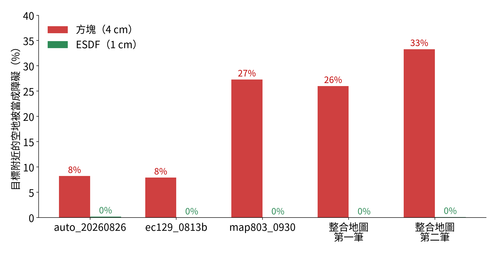

# Benchmarks and validation

Measurements behind the current defaults, with the scripts in [`validation/`](../validation/README.md). Thor = Jetson
Thor, 120 W mode, GPU shared with other containers; "3 lab maps" = auto_20260826, ec129_0813b, map803_0930, 60 requests.

## Scenario tests (`validation/run_scenarios.py`)

One condition of the synthetic test scene (`test_maps/`: a can on a table behind a board, a cabinet on the left, walls
behind and to the right) is changed per scenario, to check every `reason` appears where it should. 9/9 pass, with and
without the ESDF:

| Scenario | Change | reason |
|---|---|---|
| `baseline` | none | `ok` (fallback, 0.67) |
| `loose_threshold` | `threshold` 0.5 | `ok` (0.63) |
| `unreachable` | gripper 2 m above the floor | `no_ik_solution` |
| `gripper_in_cabinet` | gripper inside the cabinet | `no_ik_solution` |
| `cone_closed` | safety cone ±0° | `outside_cone` |
| `no_drivable_area` | nothing drivable within 1.2 m | `cannot_park` |
| `sloppy_navigation` | navigation error ±15 cm, ±15° | `not_robust` |
| `arm_plan` | `plan_arm()` at the chosen station | `ok` |
| `bad_stow` | stowed arm all zeros (self-colliding) | `arm_plan_failed` |

## Making it fast on the Thor

With real SLAM maps (350–950 boxes instead of 12), a request first took minutes on the Thor: 56 s to build the solvers
and 4–14 s to score each station. In order:

| Change | Effect (Thor, real maps) |
|---|---|
| Only the boxes the arm can reach from a station (provable bound; `check_near_exact.py`: 400k random arm poses never exceed 0.770 m < 0.887 m) | 942 → 135 boxes per station, ~5× faster scoring, identical scores |
| Score = LM seeds ∪ optimiser results (the optimiser was turning valid LM solutions into failures) | scores no longer depend on batch position; 8 seeds pick the same stations as 32 |
| Long-running solvers (`--serve`, `set_scene`) | 56 s per request → once at startup |
| Optimiser only where it can change the answer (`profile.lazy_optimiser`) | scoring 3.2 → 1.3 s, same answer 59/60 |
| Box fitting in parallel (`map.box_workers`) | scene 1.22 → 0.26 s, identical boxes |
| Arm trajectory moved out of `plan()` | request median 1.95 → 1.66 s |
| ESDF near the target | 15 → 20 stations found on the 3 lab maps, 1.60 → 1.48 s |
| Processed-map cache, vectorised wrist merge | map 3.8 s → 7 ms after the first time; merge 0.59 → 0.11 s (identical points) |

Profiling (`profile_plan.py`) showed 99% of scoring time in the optimiser, which rescued only 2.9% of the perturbations
LM missed — hence the lazy optimiser rather than removing it.

## ESDF near the target

`overcover.py`: volume within 50 × 50 × 70 cm of the target that is farther than 3 cm from any point, yet inside an
obstacle:

| Thor, same requests | Boxes only | Boxes + ESDF |
|---|---|---|
| 3 lab maps: stations found | 15 | **20** |
| … median request with a station | 1.60 s | **1.48 s** |
| fused test map, 57 grasps: stations found | 0 | **28** |
| … median request with a 27/27 station | — | **0.97 s** |

The 3 lab-map requests only the boxes solved: their arm path at the box version's station presses 5–8 mm into points
1.6–2.7 cm from the bottle, so the finer model rejects grasps that were really scraping. Safety check of the fused-map
stations: [grasp_lab.md](grasp_lab.md).

## Robustness check: 9 points vs 27, and bounds (`bench_bound.py`)

| Thor, median | 3 lab maps: 27/27 · fallback (slowest) · total scoring | fused map: 27/27 · fallback (slowest) · total scoring |
|---|---|---|
| 27 points (default) | 1.13 s · 2.92 s (8.6) · 57 s | 0.73 s · 7.09 s (10.6) · 110 s |
| 27 + bounds | 0.78 s · 2.83 s (4.6) · 45 s | 0.53 s · 4.79 s (7.9) · 82 s |
| 9 points | 0.47 s · 1.71 s (3.0) · 25 s | 0.49 s · 2.75 s (4.1) · 44 s |
| 9 + bounds | 0.47 s · 1.53 s (2.0) · 21 s | 0.49 s · 2.38 s (3.2) · 38 s |

- **Bounds** (`profile.bound_scoring`, off): after LM a station's score lies between what LM solved and that plus the
  unsolved perturbations; stations whose upper bound cannot win skip the optimiser. Same selection rule.
- **9 points** (`robustness.perturb_points: 9`, off): 45 of 46 stations that passed 9 points also pass all 27; the
  fallback ranking is coarser (3–5 weak picks on the fused map).
- Run-to-run variation is the yardstick: the same settings repeat exactly, but merely reversing the request order makes
  the default pick a different station in 26 of 27 cases (cuRobo's internal random state follows the call sequence).
- Next: "9 points to search, 27 to confirm" should keep today's quality at nearly the 9-point speed.

## Fewer checks and an early stop: the default since 2026-10-24 (`bench_perturb.py`)

60 requests (3 lab maps × 2 start distances × 10 grasp directions), Thor, one setting after another in the same
session (other lab containers running, so absolute times vary). "27-check" re-scores each chosen station with all 27.

| Setting | 27/27 found | no IK solution | fallback | 60 requests | up to 10 grasps, stop at first pass (6 runs) | chosen stations passing all 27 |
|---|---|---|---|---|---|---|
| full27 (previous default) | 1.55 s | 2.34 s | 5.08 s | 162 s | 78.5 s | 12/12 |
| full27 + early stop | 1.36 s | 0.83 s | 5.27 s | 113 s | 46.3 s | 11/11 |
| xy9 (position only) | 0.82 s | 2.31 s | 1.98 s | 117 s | 57.9 s | 8/13 (worst 24/27) |
| xy5 (position only) | 0.65 s | 2.32 s | 1.51 s | 108 s | 53.4 s | 9/13 (worst 24/27) |
| xy5 + early stop | 0.64 s | 0.85 s | 1.46 s | 55 s | 25.5 s | 8/12 (worst 22/27) |
| corners9 | 1.04 s | 2.33 s | 2.18 s | 122 s | 59.5 s | 12/12, the same 12 stations as full27 |
| **corners9 + early stop (default)** | **0.90 s** | **0.85 s** | **2.45 s** | **69 s** | **31.2 s** | 11/12 (worst 25/27) |

- **Yaw matters**: with the arm reaching 0.5–0.8 m, a 5° heading error moves the gripper 4–7 cm, as much as the
  position error. Position-only sets (xy9, xy5) pick a station that fails some 5° error a third of the time. Use them only
  if Kachaka's measured heading error turns out much smaller than 5°.
- **Early stop**: when the whole-body IK finds nothing in its first round, the next three rounds found nothing either in
  36 of 36 impossible requests; each round costs ~0.5 s because cuRobo only exits early once a solution exists.
- Requests where a setting picks a different station than full27 stay within the run-to-run variation (full27 with the
  requests reversed also differs in one).
- Overall: 2.3× less time for the 60 requests; trying grasps until the first pass, 2.5× (e.g. 16–21 s → 6–8 s when the
  first five grasps are impossible).

## Tried and kept off

- **Cropping the map to the arm's reach** (`map.crop_to_window`, `bench_roi.py`): the 1.8 m ROI is already about the
  arm's reach; smaller search windows saved ~0.3 s of scene building but found fewer stations and made requests slower.
- **A finer box grid near the target** (1–2 cm cells): accurate enough, but 800–6000 boxes instead of ~350 — too slow on
  the Thor. Replaced by the ESDF.

## Known limitations and open items

- **Navigation error ±5 cm / ±5° is assumed**; measure Kachaka's real error.
- **Fallback requests are slow** (5–11 s on the Thor) because every candidate is scored.
- **Grasp orientation is fixed by upstream.** An obstacle right in front of the bottle blocks every grasp from that side;
  upstream then has to supply another grasp.
- **Maps**: merging should move to the teammate's complete version; the API → Piper mount must be calibrated.
- `no_ik_solution` is not a proof; a colliding gripper pose is reported the same way.
- Only the Kachaka body is modelled for the base; the column holding the arm is not, and the camera pole on the right
  side is missing from `robot.kachaka.extra_spheres`.
- Space under tables etc. is solid in the box model (the ESDF keeps gaps over 5 cm only near the target).
- cuRobo v2's `collision_checking.validate()` has a bug in this version; parking is checked with numpy instead.
