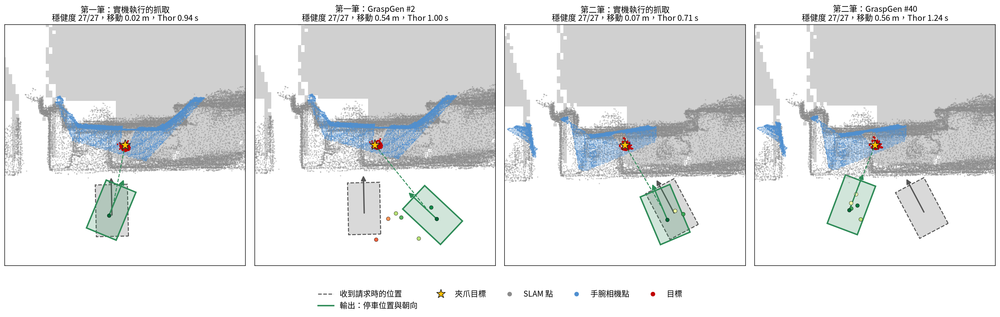

# The teammate's aligned wrist scene (Grasp Lab Global)

The coarse SLAM map is blurry near small objects, and it may have been scanned on a different day than the grasp. A
teammate's **Grasp Lab Global** (in `mm_system_prod`) aligns the wrist camera's view to the SLAM map and saves
`map_from_arm` (Piper base → map) with every capture. **The alignment is the teammate's work; this project only reads
it.** [`grasp_lab.py`](../grasp_lab.py) turns a saved capture into our input without changing any of their code:

```bash
python grasp_lab.py --lab-map <map dir> --run <grasp_logs/run> [--run ...] --out <dir> [--top 32] [--drop-stale]
python run_demo.py --serve < <dir>/<run>_requests.jsonl
```

In code: `grasp_lab.load_capture()`, `fuse()`, `requests()`, `kachaka_pose()` (see [usage.md](usage.md)).

## What it does

- **Frames**: their map x, y equal ours (same `alignment_*.yaml`); their z keeps the raw plane-normal height, so
  `floor_height_m` (returned by `load_lab_map`) is subtracted.
- **Gripper pose**: a GraspGen grasp frame is `gripper_base` turned −90° about z (checked with FK of the arm's executed
  final pose), so `pinch_center = grasp · Rz(90°) · (0, 0, 0.12 m)`.
- **Merging — a stop-gap until the teammate delivers merged maps**: SLAM points the wrist camera saw through (more than
  5 cm in front of the measured depth) are dropped, and the depth image is added as 1 cm voxels. The target is the
  segmented pixels within 1.5 cm of Grasp Lab's cleaned object cloud; other masked pixels are depth-edge mixed pixels and
  are left out.
- **`--drop-stale` (this test data only)**: map803 was scanned on 9/30 with several bottles on the table; the captures
  are from 10/08 with one. SLAM objects of the target's class mostly inside the camera image are dropped. The videos in
  the README use this cleaned map. A map scanned together with the capture does not need it.

## Checks on the test data (reported, nothing corrected)

- Wrist points lie a median 1.2 cm from the SLAM points and the bottle stands on the SLAM table: the alignment is good.
- The arm base implied by `map_from_arm` is 0.42 / 0.47 m high (mounted at 0.525 m) and tilted 9° in one capture, so
  the robot's start pose derived from it is only approximate (the API → Piper mount is not calibrated yet).
- In the SLAM map the bottles of 9/30 are blobs (14–51 cm) that the wrist camera sees through 72–94%: they are no longer
  there.



*Thor `plan()` output on the cleaned test map: both executed grasps need only a few centimetres of driving; GraspGen's
other candidates about 0.5 m.*

## Results on the two captures (Thor)

| | Boxes only | Boxes + ESDF |
|---|---|---|
| 57 grasps (executed + GraspGen): stations found | 0 | **28** |
| median request with a 27/27 station | — | **0.97 s** |

- Every one of the 28 stations was checked independently: `plan_arm()` from the station, then URDF FK spheres measured
  against the **raw points** (not the grid). 28/28 planned, gripper error 0 mm; ignoring points within 1 cm of the
  bottle, 27/28 stay clear the whole way, one touches a point 1.7 cm from the bottle by 1.6 mm (inside the 3 cm target
  allowance).
- Most GraspGen grasps on this capture remain impossible: 8 of 14 representative ones have only 0.2–2.8 cm of real
  clearance, others none. GraspGen's grasps all approach from the camera's side, so an obstacle right in front of the
  bottle blocks all of them.
