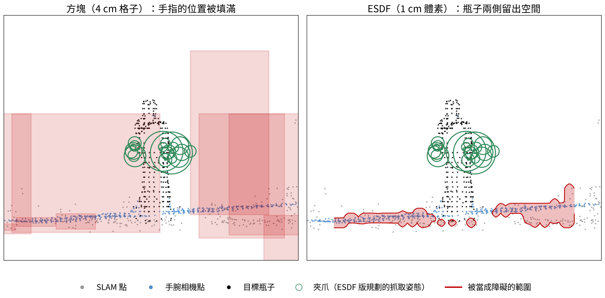

# How it works

```
SLAM npz / lab map folder  (+ wrist capture: grasp_lab.fuse)
   │ scene_io.scene_from_slam(): target points, drivable area, obstacle points
   │   far from the gripper: objects_to_boxes()  (per class → 3D-connected objects → height levels → boxes)
   │   within ±25 cm of the gripper: esdf_grid() (1 cm signed distance field)
   ▼
PlanningScene (base frame = where Kachaka is now)
   │ BasePlacementPlanner.set_scene(): obstacles written straight into the resident solvers' tensors
   │ BasePlacementPlanner.plan():
   │   1 whole_body()     9-DoF IK, one gripper pose → many candidate stations (x, y, yaw)
   │   2 _candidates()    ±30° safety cone; parking_ok(): base clear of obstacles and on drivable cells;
   │                      the current pose is added as the nearest candidate
   │   3 _lm_pass(), _finish()   each station: 27 navigation errors, 6-DoF IK each (cheap LM stage for all,
   │                      the expensive optimiser only where it can change the answer); first 27/27 wins
   ▼
chosen_map → Navigate_to_pose          (later, separately: set_scene(new scene) → plan_arm() → arm trajectory)
```

## From points to obstacles (`scene_io.py`)

- **Target**: from the mask / instance / class / cylinder, grown by 3 cm (`map.target_grow_m`) within the target's
  height range, because segmentation is never exact at the object's edge.
- **Boxes** (everything beyond the ESDF region): points are grouped per class into 3D-connected objects (4 cm voxels);
  each object's footprint is split into **height levels** (a table top at 0.41 m, a board on it at 0.71 m, a cabinet at
  0.91 m each get their own stacked boxes instead of one block at the tallest height), then covered with few rectangles
  (`decompose`). Boxes are inflated 1 cm horizontally and 0.5 cm vertically. Nothing is filled inside the target's
  footprint above its bottom (`keep_out`). Box fitting runs in parallel per object (identical result).
- **ESDF near the gripper** (`map.esdf_half_m`, default 0.25 m): boxes on a 4 cm grid fill the gap between, say, a
  carton's floor and its back wall; within 50 × 50 × 70 cm of the target they claim 8–33% of the free space
  ([benchmarks.md](benchmarks.md)), and the fingers pass within 1–3 cm of the clutter. So within ±0.25 m × ±0.25 m ×
  ±0.35 m of the gripper (above 0.15 m; lower obstacles stay boxes for the parking check) the points become a 1 cm
  signed distance field (cuRobo v2 `VoxelData`, float16, negative inside). Every 1 cm column is filled from its lowest
  to its highest point, cut at vertical gaps over 5 cm; the target's footprint is kept free as for the boxes; distances
  are reduced by 0.5 cm. Boxes and the grid are evaluated together in the same collision kernel.



*The executed grasp, sliced through the gripper: the boxes (left) fill both sides of the bottle; the ESDF (right) keeps
only the carton floor as an obstacle.*

## Search and scoring (`placement.py`)

- **Whole-body IK**: 128 seeds over base (x, y, yaw) within ±1.5 m of the current pose and the 6 arm joints, all at once
  for the one gripper pose; more rounds (up to 4) if fewer than 15 parkable candidates come back.
- **Filtering**: target within the arm's ±30° safety cone; base spheres clear of the boxes and the footprint on drivable
  cells (Kachaka's 2D map). The current pose is added as a candidate, so a robot that already stands well does not move.
- **Robustness**: Kachaka never stops exactly. Each candidate is re-solved as a 6-DoF IK at 27 perturbed base poses
  (every combination of −5/0/+5 cm in x and y and −5/0/+5° in yaw); robustness = the fraction that still reaches the
  pose. Each perturbation has its own copy of the obstacles (cuRobo multi-env), written in closed form.
- **Speed**: only obstacles the arm can reach from a station are loaded (a provable 0.887 m bound around the shoulder;
  farther ones contribute exactly zero). IK runs in two stages: Levenberg–Marquardt (cheap) for every station first,
  then the MPPI + L-BFGS optimiser (99% of the cost) only for perturbations LM left unsolved, and only for stations that
  can still change the answer. Any valid solution from either stage counts.
- **Selection**: nearest first, the first 27/27 station wins; otherwise the most robust one if it reaches `min_accept`.

## Frames

| Frame | Definition |
|---|---|
| map | the SLAM / Kachaka map; every input file is in it |
| base | Kachaka **now**: centre of the turning axis on the floor, x forward, z up; planning happens here (`scene_io.map_to_base_xy`, `quat_map_to_base`, `base_to_map_pose`) |
| Piper base | the arm's `base_link`, mounted at (0.08, 0, 0.525) m in the base frame |

## Files

```
curobo-base-placement/
├─ config.yaml           every assumption and parameter
├─ base_placement.py     BasePlacement: the one call for the robot system (find_standpoint)
├─ placement.py          BasePlacementPlanner: solvers, set_scene(), plan(), plan_arm()
├─ scene_io.py           point cloud + request → PlanningScene (target, drivable area, boxes, ESDF grid)
├─ robot_model.py        the 9-DoF cuRobo model (Kachaka x, y, yaw + Piper), safety cone, reach bound
├─ lab_map.py            the lab's exported map folder → map-frame points (cached in .map_cache/)
├─ grasp_lab.py          Grasp Lab Global captures → merged points + requests
├─ run_demo.py           command line: one request, --serve, --arm
├─ demo_multi_grasp.py   the whole flow with N grasps
├─ bundle.py             pack everything into one script for a GPU server
├─ make_test_maps.py, test_scene.yaml, test_maps/   the synthetic test scene
├─ validation/           tests and benchmarks; the main code never imports them (validation/README.md)
├─ assets/               robot129.yml (cuRobo config, collision spheres), URDF and meshes
└─ docs/                 these documents and the media in them
```
